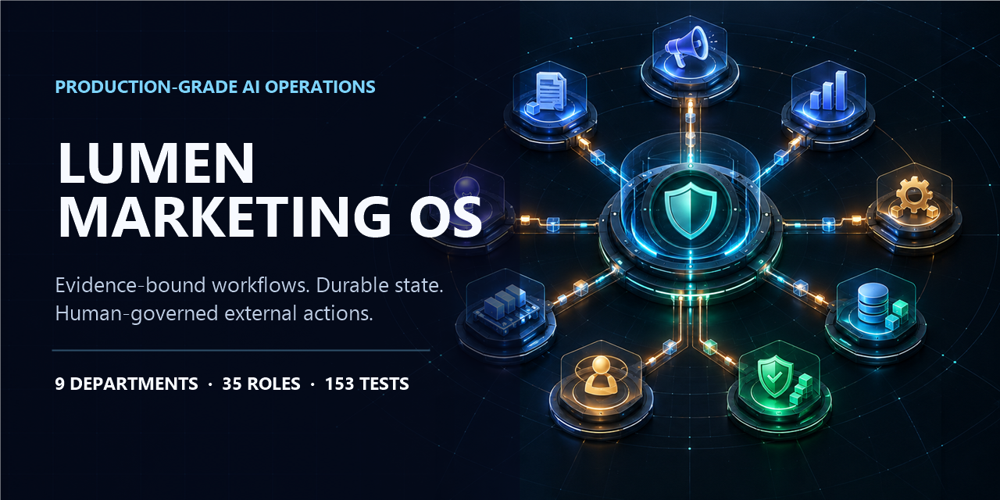
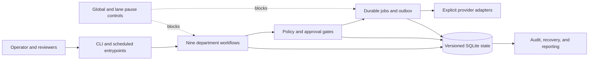
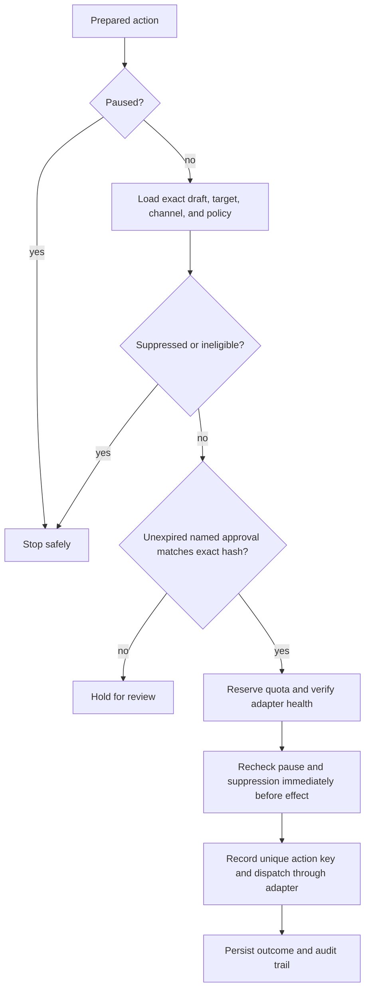

# Lumen Marketing OS

[](https://github.com/aderofrank402-spec/lumen-marketing-os/actions/workflows/ci.yml)


[](LICENSE)

**An evidence-bound, local-first control plane for coordinating AI-assisted marketing operations without turning drafts into unreviewed external actions.**

Lumen Marketing OS models research, qualification, content, outreach, community, discovery, compliance, operations, and support as durable workflows. It separates evidence gathering from decisions and decisions from side effects, then puts pause controls, exact-hash approvals, suppression checks, quotas, leases, and audit records between them.

> **Current boundary:** the development profile is dry-run by default. The repository proves orchestration, persistence, policy enforcement, and review workflows; it does not claim unattended live outreach or fully connected third-party providers.

## Engineering evidence

| Evidence | What is present in this repository |
|---|---|
| Test suite | **153 tests passing** in the public snapshot |
| Agent model | **35 logical roles** organized across nine departments |
| Persistence | **18 checksum-tracked SQLite migrations** containing 101 table definitions |
| Runtime safety | Durable leases, heartbeats, retries, review states, dead-letter handling, and an idempotent outbox |
| Action safety | Exact content hashes, named approvals, suppression checks, quota reservations, provider-health gates, and last-moment rechecks |
| Operations | Global and lane-level pause controls, schedulers, backup verification, recovery, audit trails, and usage accounting |

The 35 roles are logical responsibilities and guarded workflow boundaries—not 35 continuously running processes.

## Why this exists

Most automation demos focus on generating a message. Production systems must also answer harder questions: What evidence supported it? Who approved the exact copy? Is the recipient suppressed? Was quota reserved? Did a retry duplicate the action? Can the operator stop one lane without corrupting the queue?

This project treats those questions as first-class product requirements.

## System map



### Nine departments

| Department | Roles | Responsibility | Enforced boundary |
|---|---:|---|---|
| 1 · Research | 4 | Trends, forums, competitors, and directory signals | Sourced findings enter review; they do not become automatic claims |
| 2 · Qualification | 3 | Enrichment, fit decisions, and decision-maker review | Ambiguous identities and weak evidence remain unresolved |
| 3 · Content | 4 | Personalization, technical writing, experiments, and critique | Drafts stay separate from approvals and dispatch |
| 4 · Outreach | 3 | Dispatch inspection, inbound intent, and meeting proposals | Exact approved content and recipient/channel must match |
| 5 · Operations | 2 | Scheduling, recovery, usage accounting, and backups | Durable state, pause handling, and integrity checks govern execution |
| 6 · Community | 5 | Reddit, Hacker News, launch, LinkedIn, and list indexing | Research and draft preparation only until an approved handoff |
| 7 · Governance | 6 | Content integrity, quotas, loops, growth audit, lag, and suppression | Fail-closed controls can stop unsafe or uncertain actions |
| 8 · Discovery | 4 | Use-case scouting, deep validation, prospect evidence, and routing | Independent support and counter-evidence are required before escalation |
| 9 · Support | 4 | Feedback intake, triage, sheet projection, and reply preparation | Replies are reviewed artifacts; sending is not implicit |

## The final action gate



See [the control model](docs/CONTROL_MODEL.md) for the full fail-closed sequence.

## Run it locally

Requirements: Python 3.11 or newer and PowerShell on Windows for the commands below.

```powershell
python -m venv .venv
.\.venv\Scripts\python.exe -m pip install -e ".[test]"
Copy-Item .env.example .env
.\.venv\Scripts\lmos.exe init
.\.venv\Scripts\lmos.exe status
.\.venv\Scripts\lmos.exe check
.\.venv\Scripts\python.exe -m pytest -q
```

The generated SQLite runtime lives under `runtime/` and is excluded from version control. No real credentials are included; provider configuration belongs in the local `.env` file.

For a concrete queue, pause, recovery, and approval walkthrough, read the [operator walkthrough](docs/OPERATOR_WALKTHROUGH.md).

## Repository tour

```text
src/lumen_marketing_os/
├── adapters/          # explicit external-system boundaries
├── cli/               # operator commands
├── db/                # SQLite access and versioned migrations
├── engine/            # durable queue and outbox primitives
├── policy/            # pause, approval, quota, and suppression controls
└── workflows/         # department-specific runtimes

config/                # environment and schedule configuration
tests/                 # unit, integration, policy, and workflow tests
docs/                  # concise portfolio-oriented guides
```

## Verification

The CI workflow runs the public-repository validator and the complete pytest suite on Python 3.11 and 3.12. Locally:

```powershell
python scripts/validate_public_repo.py
python -m pytest -q
```

The validator checks required portfolio files, relative Markdown links, accidental secret-like values, forbidden runtime artifacts, and the presence of explicit operating boundaries.

## Design decisions

- **SQLite before distributed infrastructure:** one transactional local store keeps the early operating model inspectable and recoverable.
- **Durable handoffs before in-memory agent chains:** every consequential transition survives process restarts and can be audited.
- **Approval bound to content:** approval records match the exact content hash, target, and channel rather than a vague campaign label.
- **At-least-once delivery with idempotency:** queues and outboxes assume retries; unique action keys prevent duplicate effects.
- **Fail closed on uncertainty:** missing policy evidence, suppression state, provider health, or approval blocks action.

The trade-offs and rejected alternatives are recorded in [engineering decisions](docs/ENGINEERING_DECISIONS.md).

## Documentation

### Start here

- [Portfolio architecture](docs/PORTFOLIO_ARCHITECTURE.md)
- [Control model](docs/CONTROL_MODEL.md)
- [Operator walkthrough](docs/OPERATOR_WALKTHROUGH.md)
- [Engineering decisions](docs/ENGINEERING_DECISIONS.md)

### Deep technical references

- [Architecture](ARCHITECTURE.md)
- [Workflow specification](WORKFLOW_SPEC.md)
- [Data model](DATA_MODEL.md)
- [Permissions and approvals](PERMISSIONS_AND_APPROVALS.md)
- [Runtime and scheduling](RUNTIME_AND_SCHEDULING.md)
- [Integration contracts](INTEGRATION_CONTRACTS.md)
- [Test and operations plan](TEST_AND_OPERATIONS_PLAN.md)
- [Traceability matrix](TRACEABILITY.md)
- Department runbooks and verification registers in the repository root

## Scope and limitations

- This repository contains the marketing orchestration and control system, not the private Lumen Sieve product source.
- Development mode disables external effects by default.
- Live provider connections require the operator's accounts, credentials, configuration, and explicit approval policy.
- Some provider and browser handoffs are intentionally represented as adapter boundaries rather than claimed as live integrations.
- Running on a local machine means scheduled work stops when that machine is off; production deployment would require a supervised always-on host.

## Author

Built by [Frank Adero](https://github.com/aderofrank402-spec), a backend and AI-agent engineer focused on production systems, durable automation, and evidence-bound workflows.

## License

Released under the [MIT License](LICENSE).
