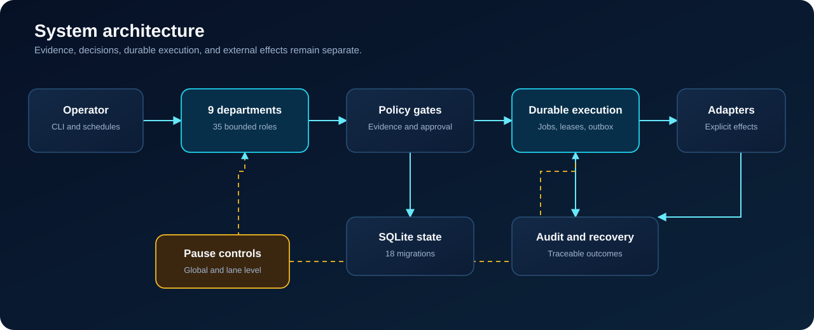

# Portfolio architecture

This guide explains the repository at interview depth: what enters the system, where decisions happen, how work survives failures, and where external effects are constrained.

## Runtime layers

1. **Entrypoints** — CLI commands and scheduled occurrences translate operator intent into explicit workflow calls.
2. **Department runtimes** — nine bounded workflow areas implement research, qualification, content, outreach, operations, community, governance, discovery, and support responsibilities.
3. **Policy controls** — pause, approval, quota, suppression, provider-health, and content-integrity checks decide whether work may advance.
4. **Durable execution** — SQLite-backed jobs, leases, heartbeats, retries, review states, and an outbox preserve work across restarts.
5. **Adapters** — network-capable behavior is isolated behind explicit interfaces so local logic can be tested without accidental side effects.
6. **Audit and recovery** — state transitions, decisions, outcomes, backups, and recovery operations remain inspectable.



## Persistence model

The database schema is built by 18 ordered, checksum-tracked migrations. The tables cover domain records, runtime jobs, research, qualification, content, outreach, operations, community, governance, discovery, support, and reviewed handoffs.

The runtime uses a durable state machine rather than an in-memory chain:

```text
pending → leased → complete
                 ↘ retry → pending
                 ↘ review
                 ↘ dead-letter
```

A worker receives a time-limited lease. Heartbeats renew live work. Expired leases can be recovered. Failures are classified before retry, and uncertain external effects are held for review rather than replayed blindly.

## Scheduler model

Schedules create idempotent occurrences. An occurrence produces a durable job; it does not directly execute an external effect. This distinction lets the scheduler recover from interruption without duplicating the downstream action.

## Security boundary

Configuration files define behavior, not secrets. Credentials are read from a local environment file that is excluded from Git. External adapters remain explicit, and the development profile sets `dry_run` to `true`.

## What this architecture demonstrates

- Transactional workflow design and schema evolution
- Reliable local job execution with recovery semantics
- Separation of evidence, decisions, approvals, and effects
- Policy-as-code for high-risk automation
- Testable adapter boundaries around external systems
- Operational thinking beyond prompt orchestration

For exact execution gates, continue to [Control model](CONTROL_MODEL.md). For commands, use the [Operator walkthrough](OPERATOR_WALKTHROUGH.md).
